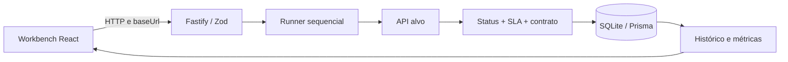

# Análise do Spectr TestOps e direção visual

Análise inicial: 22/10/2026. Revisão: 24/10/2026. Referência funcional e visual: aplicativo Postman. Escopo: frontend, animações/transições, fluxos HTTP, runner, persistência, configuração e dependências do repositório.

Esta análise combina leitura do código, builds, testes automatizados, chamadas HTTP locais e inspeção no Chromium. Os critérios de interface seguem padrões do Postman; não foi realizada comparação pixel a pixel com uma versão específica do aplicativo.

## 1. Diagnóstico

A base visual já aproxima o Spectr do Postman: separação entre coleções e workbench, cores por método HTTP, barra de URL com Send, abas técnicas e painel de respostas. React/Vite e Fastify/Prisma permitem um fluxo local simples, sem serviços de banco externos.

O principal problema encontrado foi a confiabilidade do feedback: erros de conexão podiam virar respostas de sucesso, o histórico vazio mostrava execuções fictícias e violações de SLA não reprovavam uma coleção. Melhorias visuais precisam preservar a correspondência entre o que a interface apresenta e o que o motor realmente executou.

A revisão de 24/10 conclui o redesign, o editor persistente e o acesso multiusuário. Veja [REDESIGN_POSTMAN.md](REDESIGN_POSTMAN.md) e [VALIDACAO.md](VALIDACAO.md) para o estado atual e suas evidências.

### Achados e correções

| Área | Comportamento anterior | Alteração |
|---|---|---|
| Execução individual | Falha do backend acionava fallback no navegador e podia fabricar HTTP 200 | Usa o resultado real do backend e apresenta erro persistente quando indisponível |
| Coleções | Status e contrato aprovados podiam ocultar SLA reprovado | PASS exige status, SLA e contrato aprovados |
| Latência / timeout | Medição e timer terminavam após os headers | Medição e timeout abrangem a leitura integral do corpo |
| Contratos | Corpo vazio e valores primitivos escapavam de certas validações | Motor compartilhado cobre vazios, primitivos e schemas booleanos |
| Ambientes | Destino exibido podia divergir do usado pelo servidor; porta local incorreta | Single e coleção enviam `baseUrl`, validada como HTTP(S), sem alterar a coleção |
| Histórico | Lista vazia apresentava registros fictícios | Estado vazio real; estados PENDING/RUNNING diferenciados de FAIL |
| Chaos Lab | Erros geravam simulações locais e percentis projetados sem base estatística | Mostra resposta real, latência observada e falhas de rede; remove percentis inventados |
| Formulários | Erros podiam fechar o modal e apagar os campos | Mantém dados, apresenta erro, bloqueia submissão duplicada |
| Acessibilidade | Modais sem ciclo de foco e controles pouco descritivos | Foco inicial/retorno, Tab contido, Escape, labels e anúncios de erro |
| Responsividade | Ações escapavam do header; sidebar consumia quase toda a largura no celular | Header adapta distribuição; coleções ficam recolhíveis e editor mantém largura útil |
| Animações | Movimento sem respeitar preferência do sistema | `MotionConfig` e CSS respeitam movimento reduzido; transições curtas |
| Resultados / exportação | Seleção e relatórios podiam misturar contextos e limites de SLA fictícios | Reseta resposta por contexto, usa dados reais e protege células CSV contra fórmulas |
| Login e workspaces | API não autenticada e consultas globais | Sessões HttpOnly e verificação de associação ao workspace em cada recurso |
| Editor | Requisições somente para leitura | Edição de método, URL, parâmetros, headers, body, SLA e contrato; Save/Discard e execução de rascunho |
| Saída HTTP | Chamadas arbitrárias a redes internas e credenciais em redirects | Validação/pinning de destinos, bloqueio de redes privadas, limite de resposta e headers seguros em mudança de origem |
| API | Parâmetros frágeis, recursos ausentes como 500, CORS refletindo qualquer origem | Validação centralizada, 400/404 adequados e origem CORS configurada |
| Seed | Apagava coleções e histórico; incluía senha para serviço externo | Idempotente, local, sem credenciais externas e sem apagar dados |
| Dependências | Auditoria reportava vulnerabilidade crítica no servidor | Patches compatíveis aplicados sem migração forçada de frameworks |

## 2. Direção visual: manter o workbench próximo ao Postman

### Estrutura e hierarquia

- **Barra global:** marca, workspace, busca, idioma e tema em 44 px. A navegação ocupa um rail lateral; ambiente e Run pertencem ao contexto do editor.
- **Coleções:** lista compacta à esquerda no desktop, método HTTP legível e seleção com contraste. No celular, painel recolhível para preservar espaço de trabalho.
- **Editor:** método + URL + Send como linha principal; ambiente na linha de contexto; abas para parâmetros, headers, corpo, testes/SLA e contrato; limites editáveis na aba de testes.
- **Resposta:** separar conteúdo, headers e resultados de teste. Status, tempo e contagem precisam vir dos dados da execução. Relatórios só ficam disponíveis quando existem resultados.
- **Estados vazios:** instrução curta e ação concreta para criar coleção, adicionar requisição ou enviar uma chamada. Nunca preencher espaço com telemetria inventada.

### Tokens e densidade

A paleta existente em `client/tailwind.config.js` é apropriada: laranja `#FF6C37`, canvas escuro `#1C1C1C`, superfícies `#212121`/`#262626` e bordas `#333333`. Manter cores funcionais para métodos HTTP e estados. Evitar introduzir gradientes decorativos, sombras grandes ou cartões de dashboard no editor.

Usar tipografia de interface para navegação e textos; monoespaçada para métodos, caminhos, payloads e métricas. Manter bordas de 1px, alinhamento consistente e espaçamento compacto. O foco visível laranja permite navegar sem depender do mouse.

**Refinamento aplicado:** controles e espaçamento padronizados, árvore de coleções única e separação de editor/resposta com divisor ajustável. Ainda cabe uma auditoria formal de contraste e acessibilidade. As verificações desta entrega não constituem certificação WCAG.

### Animações e transições

As entradas de módulos usam transições curtas de opacidade e deslocamento discreto. A troca desmonta a view anterior imediatamente para não depender da conclusão de animações internas e travar a navegação. A navegação usa indicadores discretos e transições de cor. Modais usam entrada leve e os controles têm feedback de hover/press. Os tempos ficam na ordem de 150–200 ms para navegação e diálogo, com preferência por `transform` e `opacity`.

`prefers-reduced-motion` reduz animações CSS e desativa transformações via Framer Motion. Evitar cascatas longas no console com muitas asserções; uma execução grande deve continuar navegável imediatamente. Uma futura otimização deve limitar animações por linha ou virtualizar listas grandes.

## 3. Funcionalidade e arquitetura

### Capacidades verificáveis

- Cadastro/login, logout e criação/seleção de workspaces privados.
- CRUD de casos e edição persistente de método, path, parâmetros, headers, corpo, status, SLA e contrato.
- Envio do rascunho sem alterar a configuração salva; execução de coleção usa casos salvos.
- Execução individual com retorno do corpo e headers; execução de coleção com persistência de asserções.
- Encadeamento de tokens de autenticação entre chamadas na coleção.
- Cálculo nearest rank de percentis sobre latências por caso.
- Echo, atraso, falha HTTP e comportamento intermitente no laboratório local.
- Histórico e exportação JSON/CSV, temas claro/escuro e idiomas português/inglês.

### Limites que permanecem

| Prioridade | Limite atual | Próximo passo recomendado |
|---|---|---|
| Média | Login e isolamento implementados; convites e recuperação de senha ainda ausentes | Implementar administração de membros e recuperação segura conforme necessidade do produto |
| Média | A política de saída permite APIs públicas; DNS delegado por proxy exige hostname autorizado | Operador deve configurar destinos confiáveis e política do proxy da instalação |
| Alta | Credencial de serviço externo existia no código anterior | Rotacionar fora do repositório se ainda válida; remoção desta versão não apaga o histórico Git |
| Alta | Fastify 4 e toolchain antigo têm advisories sem correção compatível completa | Migrar Fastify/plugins, Vite e Tailwind em entregas separadas com regressão |
| Média | Requests e coleções executados de forma síncrona | Jobs com estado e limites de concorrência; depois streaming e cancelamento no servidor |
| Média | Validador é subconjunto de JSON Schema | Adotar validador de especificação completa e fixtures para `$ref`, formatos, composição e erros por caminho |
| Média | Sem importação/exportação de coleções Postman | Compatibilidade Collection v2.1 e importação OpenAPI, com preview antes de persistir |
| Média | Histórico mutável por cascata e dependente de SQLite local | Política de retenção, backup, auditabilidade e migração de banco se a escala justificar |
| Média | Endereços Staging são exemplos e ambientes não são CRUD | Ambientes persistentes com variáveis e substituição explícita de `{{variavel}}` |
| Baixa | Traduções ainda misturam alguns termos/textos fixos | Completar dicionário e testes de textos longos, inclusive erros e ações auxiliares |
| Baixa | Fontes remotas dependem de Google Fonts | Hospedar fontes localmente se operação offline e tipografia idêntica forem requisitos |

O cancelamento no cliente encerra a espera HTTP do navegador; não garante cancelar trabalho já iniciado no servidor. O timeout de cada chamada continua impondo o limite de execução no motor.

### Contratos de dados e métricas

`schemaValid` não significa compatibilidade completa OpenAPI. Atualmente são avaliados `type`, `required`, `properties`, `items` e schemas booleanos. Não há asserções automáticas de segurança de headers.

p95/p99 correspondem à amostra da coleção, não a uma população de tráfego nem a um teste de carga. Uma média de p95 no overview é apenas uma média dos percentis das execuções recentes, não o p95 global de todas as requisições. Não usar essa média como SLO agregado sem mudar o modelo de dados.

O schema atual não preserva todos os metadados de execução como snapshots: alterações posteriores na coleção podem mudar o contexto mostrado ao abrir o histórico. A evolução de auditoria deve persistir destino efetivo, limites, headers redigidos e versão do contrato, evitando armazenar tokens ou segredos em relatórios.

## 4. Dependências

`npm audit` consultado em 22/10/2026. Contagens são de pacotes com advisories, incluindo dependências transitivas, e podem mudar conforme o registro recebe novas informações.

| Módulo | Antes | Depois dos patches compatíveis | Pendência |
|---|---|---|---|
| Servidor | 4: 1 crítica, 2 altas, 1 moderada | 2 altas | Fastify e find-my-way; correção indicada exige major do Fastify |
| Cliente | 11: 8 altas, 3 moderadas | 9: 6 altas, 3 moderadas | Principalmente toolchain Tailwind/Vite e transitivas |

Atualizações compatíveis corrigiram `proxy-addr`, `fast-uri`, `follow-redirects`, `source-map-js` e `postcss-selector-parser`. Nenhum `npm audit fix --force` foi aplicado. Não confundir advisory de ferramenta de desenvolvimento com exploração comprovada na aplicação; planejar as migrações e validar seus efeitos.

## 5. Ambiente e evidências

Instalação com lockfiles via `npm ci`, cache em `/workspace/.npm-cache` e Prisma Client com engine normal. A atualização do schema adiciona usuários, sessões e associações sem apagar dados anteriores. O seed é opcional e seus workspaces legados não são atribuídos automaticamente a uma conta nova. Engines Prisma conferidos com os checksums oficiais por HTTPS, sem desabilitar TLS ou integridade.

O ambiente usa Node.js 24 e npm 11; a documentação do projeto admite Node 20 ou superior. Não foram executadas chamadas contra a API PayStream ou outro serviço de aplicação externo.

As verificações e resultados finais desta entrega estão em [VALIDACAO.md](VALIDACAO.md).

## 6. Ordem recomendada de evolução

1. Manter testes de confiabilidade como critério para qualquer mudança de interface ou motor.
2. Manter os componentes visuais e o editor persistente com regressão de fluxo e responsividade.
3. Evoluir convites, recuperação de senha e gestão de membros a partir do login/isolamento implementados.
4. Migrar dependências principais com os mesmos cenários de regressão.
5. Adicionar importação Postman/OpenAPI, ambientes persistentes e jobs canceláveis.
6. Evoluir armazenamento e snapshots de auditoria conforme volume e requisitos reais.
